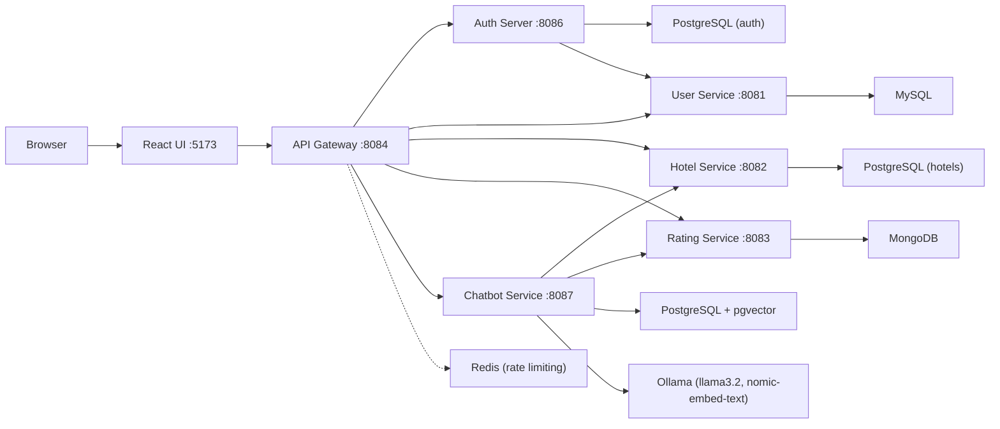

# Hotel Rating System


A distributed full-stack application built with a **microservices architecture**. Users can discover hotels, read and write reviews, and manage their profile through a React interface. Access is secured by a dedicated **OAuth2 / JWT authorization server**, and an **AI assistant** (Spring AI with a local LLM) answers questions about hotels and their reviews.

<p align="center">
  
</p>

## Table of contents

- [Features](#features)
- [Architecture](#architecture)
- [Tech stack](#tech-stack)
- [AI assistant (chatbot)](#ai-assistant-chatbot)
- [Getting started](#getting-started)
- [Configuration and security notes](#configuration-and-security-notes)
- [Containerization](#containerization)
- [Performance testing](#performance-testing)
- [Screenshots](#screenshots)
- [Roadmap](#roadmap)

---

## Features

**Users**
- Browse hotels and search by name or location
- View hotel details with ratings and reviews
- Rate hotels and leave written feedback
- View and edit a personal profile
- Ask the AI assistant about hotels, ratings and guest reviews

**Admins**
- Add, edit and delete hotels, including hotel images
- Manage users and ratings from a dedicated admin panel
- Activity log of admin actions (for example user added or deleted)

**Platform**
- OAuth2 authorization code flow with JWT access tokens, stored in HttpOnly cookies
- Role-based access control (`ADMIN` and `USER`)
- Service discovery, centralized configuration and a single API entry point
- Redis-backed rate limiting on user routes
- Graceful fallbacks in the UI when a backend service is unavailable
- Fully containerized with Docker Compose

---

## Architecture



Every service registers with **Eureka** and loads its configuration from the **Config Server**, which reads from a Git repository ([Hemant15-Bl/Config](https://github.com/Hemant15-Bl/Config)).

### Services

| Service | Port | Responsibility | Data store |
|---|---|---|---|
| Service Registry (Eureka) | 8761 | Service discovery | - |
| Config Server | 8085 | Centralized, Git-backed configuration | Git |
| API Gateway | 8084 | Routing, OAuth2 client login, token relay, rate limiting | Redis |
| Auth Server | 8086 | Spring Authorization Server: login, JWT issuing, roles | PostgreSQL |
| User Service | 8081 | User profiles and admin activity log | MySQL |
| Hotel Service | 8082 | Hotels, details and images | PostgreSQL |
| Rating Service | 8083 | Reviews and ratings | MongoDB |
| Chatbot Service | 8087 | AI assistant (RAG over hotels and reviews) | PostgreSQL + pgvector |
| Frontend | 5173 | React application served by Nginx | - |

### Gateway routes

| Path | Service |
|---|---|
| `/api/v4/**` | Auth Server |
| `/api/v1/user/**`, `/api/v1/admin/**` | User Service |
| `/api/v2/hotel/**` | Hotel Service |
| `/api/v3/rating/**` | Rating Service |
| `/chat/**` | Chatbot Service |

### Authentication flow

The browser never handles tokens directly. The gateway acts as the OAuth2 client, completes the authorization code flow with the Auth Server, and keeps the resulting JWTs in HttpOnly cookies. It then relays the token to the downstream services.

<p align="center">
  
</p>

---

## Tech stack

| Category | Technologies |
|---|---|
| Backend | Java 17, Spring Boot 3.x (Spring Boot 4 for the chatbot), Maven |
| Microservices | Spring Cloud: Eureka, Config Server, Gateway (reactive), OpenFeign |
| Security | Spring Security, Spring Authorization Server, OAuth2, JWT |
| AI | Spring AI 2.0, Ollama (`llama3.2`, `nomic-embed-text`), pgvector |
| Frontend | React, Vite, Axios, React Router, Bootstrap (reactstrap) |
| Databases | MySQL (users), PostgreSQL (hotels, auth, vectors), MongoDB (ratings), Redis (rate limiting) |
| DevOps | Docker, Docker Compose, Docker Hub images |

---

## AI assistant (chatbot)

The **Hotel Assistant** is a chat widget available to logged-in users. It is built with **Spring AI** and runs a local LLM through **Ollama**, so no external AI API or key is needed.

**How it works**

1. At startup, the Chatbot Service reads hotels and ratings from the Hotel and Rating services (through Feign).
2. Each hotel description and review is turned into an embedding (`nomic-embed-text`, 768 dimensions) and stored in **pgvector**.
3. For each question, the most relevant reviews are retrieved and sent to `llama3.2` together with the question (retrieval-augmented generation, RAG).
4. Conversation memory is kept per logged-in user, identified by the JWT subject.

**API**

```http
POST /chat
Content-Type: application/json

{ "message": "Which hotels do guests say have good food?" }
```

The endpoint requires authentication and is reached through the gateway (`http://localhost:8084/chat`).

**Requirements**

- [Ollama](https://ollama.com) installed on the host machine with both models pulled:
  ```bash
  ollama pull llama3.2
  ollama pull nomic-embed-text
  ```
- On Windows, set the environment variable `OLLAMA_HOST=0.0.0.0` and restart Ollama, so the containers can reach it through `host.docker.internal:11434`.
- A local model needs extra memory (roughly 3 GB). On a CPU-only machine the first answer can take a while. The chatbot is optional, and the rest of the application works without it.

---

## Getting started

### Prerequisites

- **Docker Desktop** (8 GB RAM allocated or more is recommended)
- **Git**
- **Node.js and npm** (only if you run the frontend manually)
- **Ollama** (only if you want the AI assistant)

### 1. Clone the repository

```bash
git clone https://github.com/Hemant15-Bl/hotel_ratings_app.git
cd hotel_ratings_app
```

### 2. Start the application

The startup script launches the services in the order they need (Eureka, Config Server, Auth Server, then the rest):

```bash
# Windows
start-app.bat
```

Or start everything directly with Docker Compose:

```bash
docker-compose up -d
```

**Startup time**

- **8 GB RAM systems:** about **4-5 minutes** with the WSL memory settings from [Troubleshooting](#troubleshooting). Without them the first boot can take **8-9 minutes**, because 8 or more JVMs start and run database migrations.
- **16 GB+ RAM systems:** expect about **2-3 minutes**.

### 3. Open the application

Once the containers show as healthy in Docker Desktop:

| What | URL |
|---|---|
| Frontend | http://localhost:5173 |
| API Gateway | http://localhost:8084 |
| Eureka dashboard | http://localhost:8761 |
| Config Server | http://localhost:8085 |
| Auth Server | http://localhost:8086 |

### Troubleshooting

- **Image pulls fail with TLS or timeout errors:** run `docker-compose pull` again, or pull images one at a time. Layers that already downloaded are kept.
- **A service is missing in Eureka:** wait a few minutes. Services start in order and register as they become healthy.
- **Chat requests are slow or time out:** check that Ollama is running, that both models are pulled, and that Docker has enough memory.
- **Docker fails, containers restart or services are killed:** this is usually a memory problem. See [Docker runs out of memory](#docker-runs-out-of-memory-windows--wsl2) below.

#### Docker runs out of memory (Windows / WSL2)

Docker Desktop on Windows runs inside a WSL2 virtual machine. Without a limit, it can take memory from Windows until both slow down or fail. Setting explicit limits makes startup both more reliable and faster. On an 8 GB machine, this cut the first boot from about 8-9 minutes to about 4-5 minutes.

1. Create or edit `%USERPROFILE%\.wslconfig`:

   ```ini
   [wsl2]
   # Example values for an 8 GB machine: tune them for yours.
   # Leave enough memory for Windows itself.
   memory=5GB
   processors=2
   swap=2GB
   
   guiApplications=false

   [experimental]
   autoMemoryReclaim=dropcache
   ```

2. Apply it by running `wsl --shutdown`, then restart Docker Desktop.
3. Check usage with `docker stats --no-stream`.
4. While developing, stop the services you do not need, for example `docker-compose stop watchtower`.

---

## Configuration and security notes

- Configuration lives in the [Config repository](https://github.com/Hemant15-Bl/Config) and is served by the Config Server. Container-specific values (database URLs, issuer URI, Ollama URL) are set as environment variables in `docker-compose.yml`.
- The credentials in `docker-compose.yml` and the OAuth2 client secret are **development defaults**. Change them, and keep real secrets out of Git, before deploying anywhere public.
- Port `8087` (Chatbot Service) is published for local debugging. In a deployment, expose it only through the API Gateway.
- Set the `secure` flag on the auth cookies to `true` when serving over HTTPS.

---

## Containerization

The whole system runs with Docker Compose.

- **Isolation:** every service, database and the frontend runs in its own container.
- **Persistence:** named volumes keep MySQL, PostgreSQL, MongoDB, Redis and the pgvector database across restarts, and hold uploaded hotel and user images.
- **Networking:** a bridge network (`rating-net`) lets services talk to each other by container name (for example `http://auth-service:8086`).
- **Startup order:** health checks and `depends_on` conditions make the infrastructure services start before the services that need them.
- **Resource tuning:** JVM flags (`SerialGC`, tiered compilation) and per-container memory limits keep memory usage low on small machines.
- **Images:** the application images are published on [Docker Hub](https://hub.docker.com/u/hemantbarole). Watchtower can optionally keep containers up to date.

```text
hotel_ratings_app
├── Backend
│   ├── ServiceRegistry     # Eureka server
│   ├── ConfigServer        # Centralized configuration
│   ├── APIGateway          # Routing, OAuth2 client, rate limiting
│   ├── AuthServer          # Spring Authorization Server
│   ├── UserService         # MySQL
│   ├── HotelServices       # PostgreSQL
│   ├── RatingServices      # MongoDB
│   └── ChatbotService      # Spring AI, pgvector, Ollama
├── Frontend                # React + Vite
├── docker-compose.yml
└── start-app.bat
```

---

## Performance testing

The API Gateway, Hotel Service and Rating Service were load-tested with [k6](https://k6.io) using the script in [`tests/load/loadtest.js`](tests/load/loadtest.js).

**Test setup**

- **Machine:** a development laptop with 8 GB RAM and 2 CPU cores, with WSL2 memory limits applied. All 8 services, the databases and k6 itself ran on the same machine, so the load generator competed with the services for CPU.
- **Traffic:** read-only requests through the API Gateway with a valid JWT: the hotel list, a hotel's details and a hotel's ratings. Each virtual user repeats the three requests and then waits (think time).
- **Not covered:** the AI assistant (a local model on CPU answers one request at a time), write requests, and the login flow.

**Results**

| Metric | Light test | Level 1 |
|---|---|---|
| Virtual users (peak) | 15 | 20 |
| Think time | 1 s | 0.2 s |
| Duration | 3 min 30 s | 1 min 45 s |
| Total requests | 5,050 | 8,443 |
| Throughput (average) | 24 req/s | 80 req/s |
| Average latency | 24 ms | 130 ms |
| Median latency | 17 ms | 101 ms |
| p95 latency | 58 ms | 309 ms |
| p99 latency | n/a | 543 ms |
| Slowest request | 0.9 s | 2.7 s |
| Error rate | 0% | 0% |

**What the results show**

- No request failed at either load level, and every threshold (error rate under 1%, p95 under 800 ms) passed.
- At 20 users with a short think time, throughput rose about 3.3 times compared with the light test, but average latency rose about 5 times. Latency growing faster than throughput suggests that requests had started to queue on the 2-core test machine.
- The slowest requests are rare spikes: the p99 is 543 ms, while the worst was 2.7 s.
- Higher load levels have not been tested yet.

**Run it yourself**

1. [Install k6](https://grafana.com/docs/k6/latest/set-up/install-k6/) and start the application.
2. Log in through the browser and copy the value of the `AUTH_TOKEN` cookie (DevTools, Application, Cookies). It is valid for 60 minutes.
3. Run the tests from the folder that contains the script:

```bash
# Light test: 15 users, 1 s think time
k6 run -e TOKEN=<AUTH_TOKEN value> tests/load/loadtest.js

# Level 1: 20 users, 0.2 s think time
k6 run -e TOKEN=<AUTH_TOKEN value> -e THINK=0.2 --stage 30s:20,1m:20,15s:0 \
  --summary-trend-stats="avg,med,p(90),p(95),p(99),max" tests/load/loadtest.js
```

> Never commit a real token. It acts like a password while it is valid.

---

## Screenshots

### User panel

<table>
  <tr>
    <td align="center" width="50%">
      <br>
      <sub>Sign in</sub>
    </td>
    <td align="center" width="50%">
      <br>
      <sub>Create account</sub>
    </td>
  </tr>
  <tr>
    <td align="center">
      <br>
      <sub>Dashboard</sub>
    </td>
    <td align="center">
      <br>
      <sub>Hotel details and reviews</sub>
    </td>
  </tr>
  <tr>
    <td align="center">
      <br>
      <sub>Profile</sub>
    </td>
    <td align="center">
      <br>
      <sub>Edit profile</sub>
    </td>
  </tr>
  <tr>
    <td align="center">
      <br>
      <sub>About</sub>
    </td>
    <td align="center">
      <br>
      <sub>Contact</sub>
    </td>
  </tr>
</table>

### AI assistant

<!--
  After uploading a chatbot screenshot to the image repository, replace the URL and remove these comment markers:

  <p align="center">
    
  </p>
-->

### Admin panel

<table>
  <tr>
    <td align="center" width="50%">
      <br>
      <sub>Admin dashboard</sub>
    </td>
    <td align="center" width="50%">
      <br>
      <sub>Users</sub>
    </td>
  </tr>
  <tr>
    <td align="center">
      <br>
      <sub>Hotels</sub>
    </td>
    <td align="center">
      <br>
      <sub>Ratings</sub>
    </td>
  </tr>
</table>

---

## Roadmap

- [ ] Sign in with Google (federated login through the Auth Server)
- [ ] Stream chatbot answers to the UI as they are generated
- [ ] Persist the JWT signing key so tokens survive Auth Server restarts
- [ ] CI pipeline that builds and publishes the Docker images

---

## Author

Built by [Hemant15-Bl](https://github.com/Hemant15-Bl). Docker images: [hemantbarole](https://hub.docker.com/u/hemantbarole).
